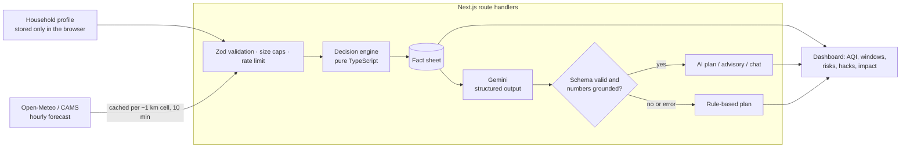

# SaafSaans: smog-season air-quality assistant

> _Saaf saans_ (साफ़ साँस) means "clean breath" in Hindi.

SaafSaans is a GenAI assistant that helps families and communities get through severe winter smog. It combines a live air-quality forecast for the family's location with details about their household. From that it plans a **lower-exposure day**, ranks **indoor-air fixes** for their home and budget, and suggests **cleaner alternatives**. Each recommendation states **its measured impact**.

**Live app:** _added after deployment_

---

## Chosen vertical

**Challenge 6: Urban Air Quality Assistant.** The persona is a family in a smog-affected Indian metro, such as Delhi-NCR in November, with children, older relatives or someone with asthma. Most of what they need to know is buried in AQI numbers. SaafSaans turns those numbers into concrete decisions about when to go out, what to wear, how to protect the bedroom, how to commute and what to tell the school group.

| Problem statement asks for…              | SaafSaans delivers                                                                                                                                                                   |
| ---------------------------------------- | ------------------------------------------------------------------------------------------------------------------------------------------------------------------------------------ |
| Help navigating severe winter smog       | Live CPCB AQI with a plain-language meaning ("≈ 11 cigarettes a day"), a 36-hour forecast, the **cleanest and dirtiest windows** and the best hour to air out the home               |
| Low-emission daily routines              | A time-blocked plan covering the morning, the school run, the commute, exercise, ventilation, cooking and sleep. Each block has a _why_ and an _impact_                              |
| Indoor air quality hacks                 | Ranked by home sealing, cooking fuel and budget. Includes **purifier sizing** (CADR for _your_ bedroom) and predicted indoor PM2.5 with and without it                               |
| Sustainable alternatives                 | A commute-swap calculator (CO2, PM2.5 and your _own_ exposure) plus household pledges (clean cooking, no open burning, inverter instead of diesel genset)                            |
| Tailored to location and lifestyle       | City search or geolocation; household members by age and condition (asthma, COPD, heart disease, pregnancy); commute; cooking fuel; purifier; draughtiness; budget; English or Hindi |
| Clearly explaining the impact of choices | Every number is computed by a transparent engine, with sources in `src/lib/constants.ts`, and shown next to the advice it supports                                                   |
| Families **and communities**             | One tap writes a shareable advisory for a school, housing society, workplace or family WhatsApp group, in English or Hindi                                                           |
| GenAI-powered assistant                  | Google Gemini writes the personalised plan, answers follow-up questions in a streaming chat and drafts community advisories, grounded in the engine's facts                          |

---

## Approach and logic

The core design choice is a **two-layer brain**: deterministic maths first, generative language second.



### 1. Decision engine (`src/lib/engine`, 100% test coverage)

Pure functions with no I/O, which makes them easy to test and audit:

- **AQI** (`aqi.ts`): CPCB National AQI sub-indices by linear interpolation for PM2.5, PM10, NO2 and O3. The AQI is the maximum sub-index. Hourly ozone is converted to the 8-hour scale using India's equivalent NAAQS limits (100 µg/m³ for 8 hours ≙ 180 µg/m³ for 1 hour). PM2.5 is also expressed as cigarettes per day (22 µg/m³ ≈ 1 cigarette, Berkeley Earth).
- **Personal risk** (`risk.ts`): each member gets a sensitivity boost of 0 to 2 for age (infant, child, elderly) or a condition (asthma, COPD, heart disease, pregnancy). Risk = AQI category rank + boost, giving low, moderate, high or very high. Mask advice follows from this, and masks are **never** suggested for children under 2.
- **Timing windows** (`windows.ts`): the forecast is scanned for the cleanest and dirtiest contiguous 2-hour waking windows and the best 1-hour mid-day ventilation slot. Windows never bridge gaps in the data.
- **Impact** (`impact.ts`): weekly CO2 and PM2.5 for each commute mode, using per-km factors and the trip's personal PM2.5 dose (concentration × in-vehicle ratio × breathing rate × time). It also covers household swaps and the exposure avoided by timing.
- **Indoor air** (`indoor.ts`): a single-zone mass balance, `C_in = P·a·C_out / (a + k + CADR/V)`, sizes a purifier for the bedroom (5 filtered air changes per hour). It predicts indoor PM2.5 with and without the purifier, then ranks hacks by expected effect and filters them by budget.
- **Fallback plan and advisory** (`routine.ts`, `advisory.ts`): a complete plan and a bilingual advisory built from facts alone.

### 2. Gemini layer (`src/lib/ai`)

- Gemini receives the **fact sheet as its only source of numbers** and returns a plan as **schema-validated JSON** (AI SDK `Output.object` + Zod).
- **Grounding guard** (`grounding.ts`): every significant number in the model's output must exist in the fact sheet. Small counts, clock times and well-known constants such as "N95" are exempt. If more than two numbers are ungrounded, the answer is discarded and the rule-based plan is shown. A test confirms that the engine's own plan passes this guard with **zero** ungrounded numbers.
- The **chat** streams plain text grounded in the same facts. The **advisory** is written for its audience and language.
- If there is no API key, a timeout, a quota error or invalid output, the app **degrades gracefully** to the rule engine. The UI shows which source produced the plan.

---

## How it works (user journey)

1. **Set up the household.** Search for your city or use your location (rounded to ~1 km), then add people, their conditions, your commute and your home. You can also tap **Try a sample Delhi family**. The profile is saved only in `localStorage`.
2. **Dashboard.** `/api/insights` returns the fast engine results immediately: AQI, cigarette equivalence, the multiple of the WHO limit, timing windows, the forecast chart with a data table, and per-person risk. In parallel, `/api/plan` asks Gemini for the personalised routine.
3. **Indoor air.** See the purifier size for your bedroom and ranked fixes with costs and impact.
4. **Your impact.** Try commute switches and household pledges; the yearly CO2 and PM2.5 totals update instantly in the browser.
5. **Ask.** Ask follow-up questions in the streaming chat ("Can the kids play outside at 4 pm?").
6. **Community.** Generate an advisory for a school, society, workplace or family group, then copy it or share it on WhatsApp.

### API

| Route                 | Purpose                                             | AI?    |
| --------------------- | --------------------------------------------------- | ------ |
| `GET /api/geocode?q=` | Up to 5 places (CDN-cacheable)                      | No     |
| `POST /api/insights`  | Fact sheet + 36-hour forecast                       | No     |
| `POST /api/plan`      | Personalised daily plan (`source: "ai" \| "rules"`) | Gemini |
| `POST /api/chat`      | Streaming plain-text answer                         | Gemini |
| `POST /api/advisory`  | Shareable community advisory, `en` or `hi`          | Gemini |

---

## Quality by evaluation area

**Code quality.** TypeScript in `strict` mode with `noUncheckedIndexedAccess`. ESLint (Next, TypeScript, jsx-a11y _strict_) runs with zero warnings, and Prettier is enforced. Modules have single responsibilities: the pure engine, I/O adapters, the AI layer, services, thin route handlers and presentational components. Every constant is named, sourced and kept in one file. Services take injected dependencies so they are testable.

**Security.** See [SECURITY.md](SECURITY.md). Highlights: the API key stays server-side; every input is validated with Zod and size-capped; per-client rate limiting; a nonce-based strict CSP and a full set of security headers; prompt-injection fencing; the numeric grounding guard; cache keys that never cross households; no stored personal data.

**Efficiency.**

- Air data is cached per ~1 km cell for 10 minutes with in-flight de-duplication.
- Geocoding is cached for a day at the CDN.
- AI output is cached by a hash of the full prompt, so repeated requests cost no tokens.
- Fast engine data loads in parallel with the slower AI plan.
- Uses a Flash-class Gemini model with compact prompts and capped output tokens.
- No chart or UI library: the chart is hand-written SVG.
- Self-hosted fonts and server-rendered HTML.

**Testing.**

- Over 250 Vitest tests across the engine, infrastructure, the AI layer (with the AI SDK's `MockLanguageModelV4`), API routes, services, client libraries and components.
- Coverage gates in CI: at least 90% overall and **100% for the decision engine**.
- Playwright end-to-end tests on desktop and mobile, with **axe WCAG 2.2 AA scans** and a check for console and CSP errors on every key screen.

**Accessibility.** WCAG 2.2 AA:

- Skip link and semantic landmarks, with one `h1` per view and ordered headings.
- Every control has a label, and hints and errors are linked with `aria-describedby`.
- A GOV.UK-style error summary takes focus when a form fails validation.
- AQI is shown with **text and a shape as well as colour**, and colours are AA-contrast in both light and dark themes.
- The chart has a text summary and a data table, and scrollable regions are keyboard-focusable.
- Live regions announce streaming chat, loading and results.
- Touch targets are at least 44 px.
- `prefers-reduced-motion` and `forced-colors` are respected.
- The body font is Atkinson Hyperlegible, designed for low-vision readers.
- Hindi content is marked `lang="hi"` and uses a Devanagari font.

**Problem-statement alignment.** See the mapping table at the top.

---

## Assumptions

- **Data source.** Open-Meteo serves the Copernicus CAMS global forecast, which is free, keyless and covers any city. Model forecasts can **under-estimate** local hotspots compared with ground monitors, so the app labels values as forecasts.
- **AQI method.** CPCB breakpoints are defined on 24-hour (PM) and 8-hour (O3) averages. They are applied to hourly values to give an "instantaneous" AQI, which is what people need to plan the next few hours. The US EPA AQI from the source is shown for cross-reference.
- **Impact figures** are transparent, rounded estimates from published factors: India GHG Platform, ICCT, DMRC, Goel et al. 2015, US EPA Exposure Factors Handbook, WHO household-energy reviews and others. They are cited in `src/lib/constants.ts` and are not regulatory measurements.
- **Indoor model.** Single-zone, steady state, 2.7 m ceilings, 80% penetration. Infiltration is set by the "draughty / average / well sealed" answer.
- **Not medical advice.** Guidance follows CPCB, WHO and paediatric norms, always escalates red-flag symptoms to emergency care (112), and never recommends masks for children under 2.
- **No accounts.** The profile is stored per browser by design, for privacy and simplicity. Rate limits and caches are per server instance, which is enough at this scale; a shared store could replace them.
- **Language.** The interface is in English. Plans, chat replies and advisories can be in English or Hindi.

---

## Run it locally

Requires Node.js 22 or later.

```bash
npm install
cp .env.example .env.local      # add GOOGLE_GENERATIVE_AI_API_KEY (free at https://aistudio.google.com/apikey)
npm run dev                     # http://localhost:3000
```

Without a key, everything works except chat; plans and advisories use the rule engine.

| Command                      | What it does                                                    |
| ---------------------------- | --------------------------------------------------------------- |
| `npm run check`              | Type check + lint + format check + tests with coverage gates    |
| `npm test`                   | Unit, API and component tests                                   |
| `npm run test:e2e`           | Playwright end-to-end and axe tests (run `npm run build` first) |
| `npm run build && npm start` | Production build and server                                     |

### Deploy (Vercel)

Import the repository in Vercel, set `GOOGLE_GENERATIVE_AI_API_KEY` (and optionally `GEMINI_MODEL`) as environment variables, then deploy. No other services are needed.

## Project structure

```
src/
  app/                  layout, page, manifest, icon, error boundary
    api/                geocode · insights · plan · chat · advisory (thin handlers)
  components/           ProfileForm, PlacePicker, Dashboard, AirNow, ForecastChart, FamilyRisk,
                        PlanView, IndoorHacks, ImpactCalculator, AskAssistant, CommunityAdvisory, ui/*
  lib/
    engine/             aqi · risk · windows · impact · indoor · facts · routine · advisory (pure)
    ai/                 model · prompts · generate · grounding
    air/                Open-Meteo air quality + geocoding clients
    services/           assistant orchestration (DI, caching, fallbacks)
    security/           rate limiting, sanitising
    client/             browser-only helpers (API client, profile store, form model, hooks)
    constants.ts        every factor and threshold, with sources
    schemas.ts          Zod schemas shared by client and server
  proxy.ts              per-request nonce CSP
tests/                  unit · api · components · e2e
```

## Credits

Air-quality data: [Open-Meteo](https://open-meteo.com/) / Copernicus Atmosphere Monitoring Service (CC BY 4.0). Geocoding: Open-Meteo / GeoNames. AQI methodology: Central Pollution Control Board, India.

Licensed under the [MIT License](LICENSE).
